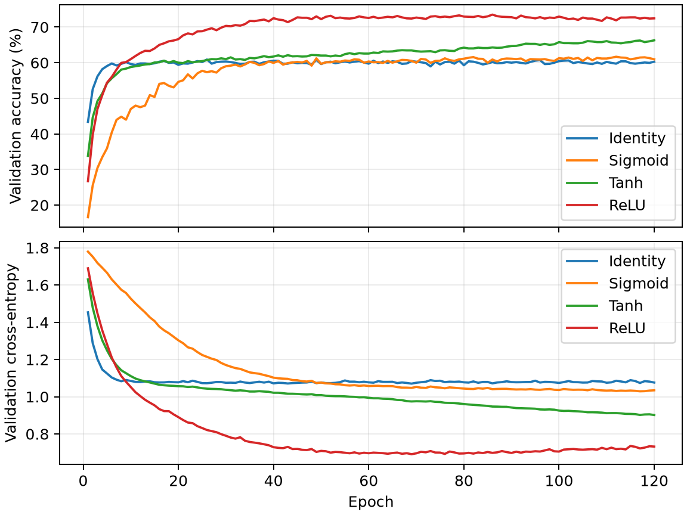
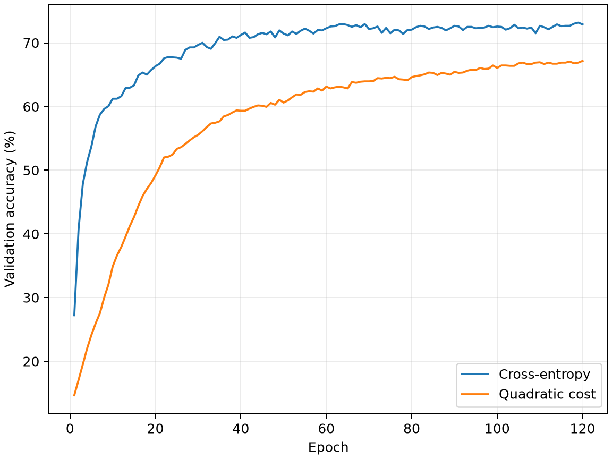
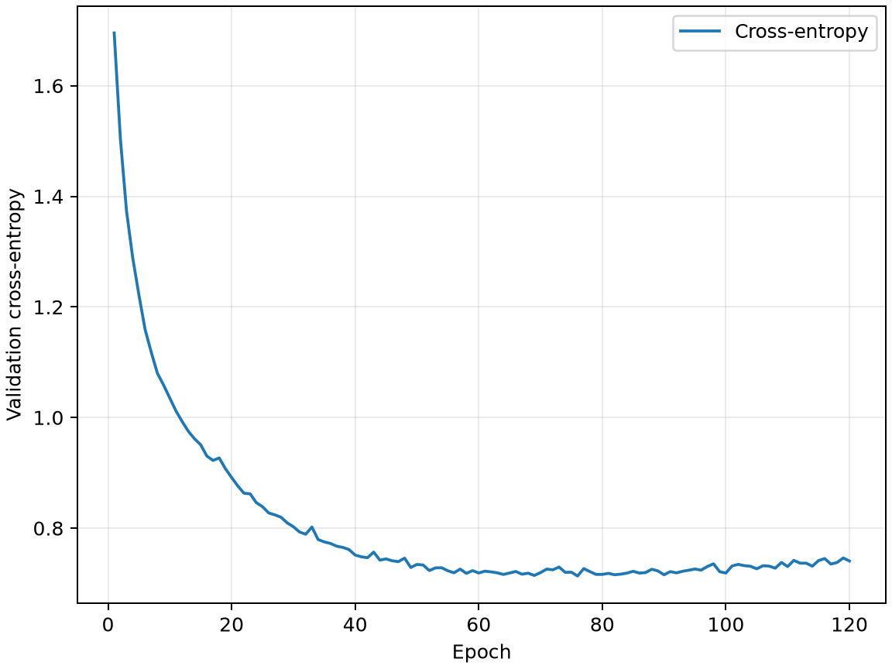
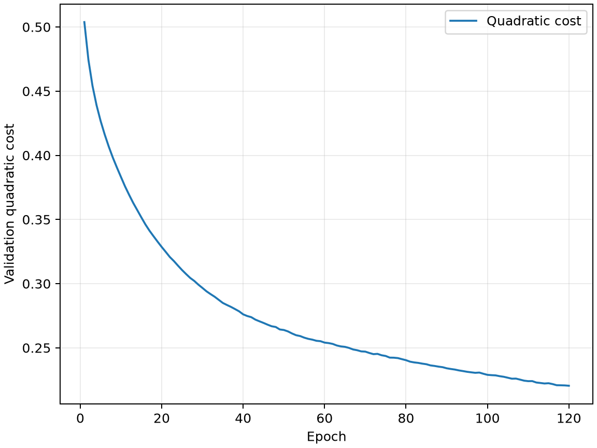
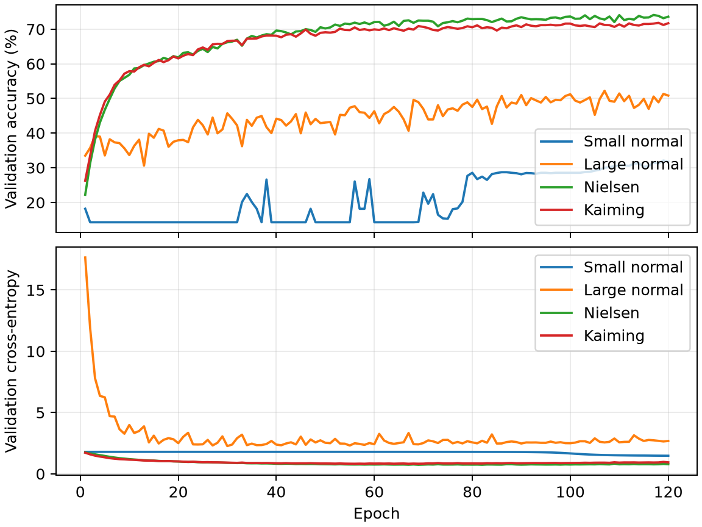
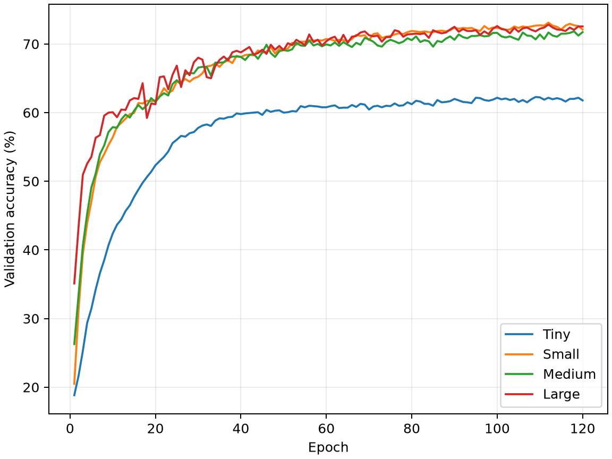
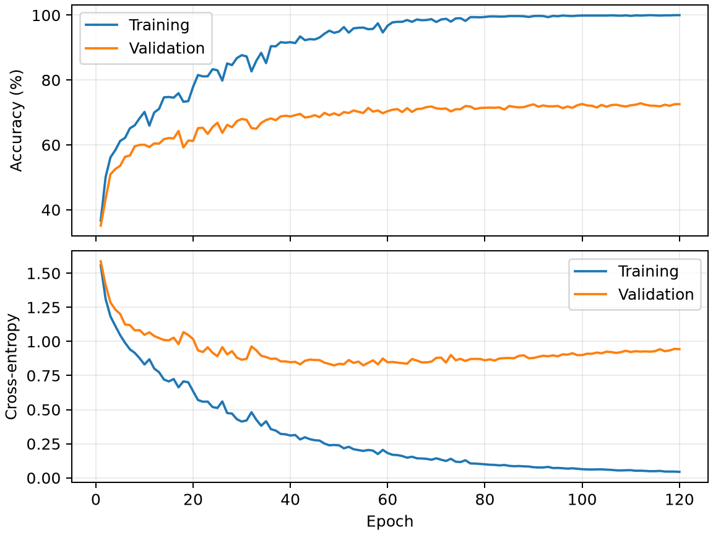
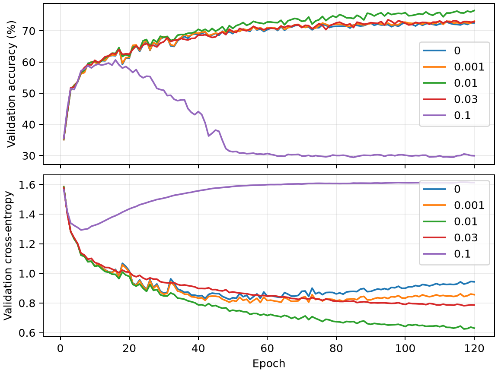
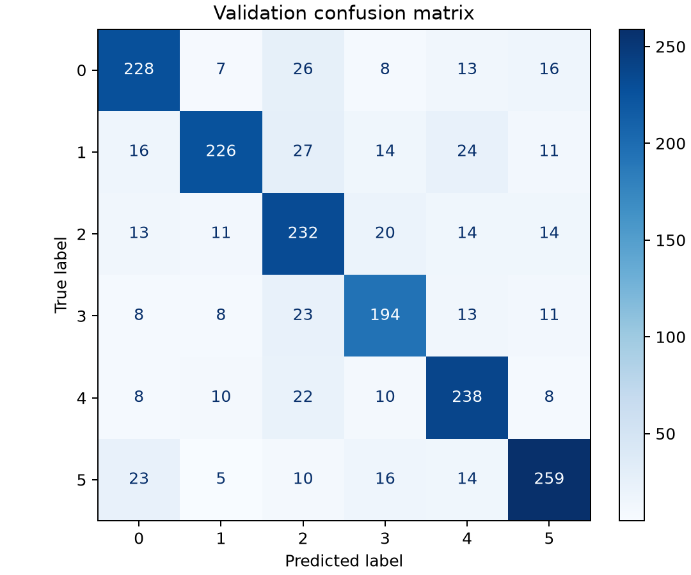
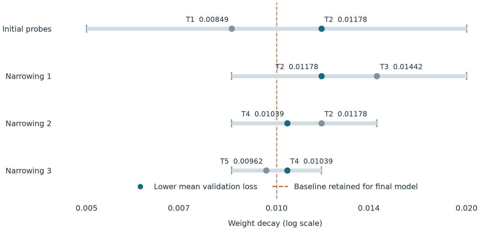

# Training and Generalization of a Multilayer Perceptron

BITS F445 | Programming Assignment 2 | Arnav Kulshreshtha | 2024ADPS0821G

## 1. Overview and experimental setup

The aim of this project is to classify the operating condition of a simulated industrial machine from 24 anonymized sensor readings, to 6 given outputs. The model produces six scores, one for each possible condition, and predicts the class with the largest score. The experiments trained on 1,800 examples and evaluated predictions on a separate set of 1,800 examples. (validation set)

Each feature of the 24 was centered and scaled using its mean and population standard deviation from the training split (it was standardized). The same statistics were applied to validation. This puts the readings on comparable scales and gives a standardized value the same meaning in both splits. Every run started fresh and trained for 120 epochs with SGD (Stochastic Gradient Descent), the batch size was 64. Loss and accuracy were measured on the complete splits after each epoch.

## 2. Part A | Activation functions

The objective of this experiment was to test how the hidden activation affects the way the network learns. We compare the following using the same network and training setup:

- Identity
- Sigmoid
- Tanh
- ReLU

By tracking validation accuracy and loss over 120 epochs, we can see which activations help the model learn faster and classify new sensor readings more accurately.

**Run conditions**

- Hidden units: 32
- Initialization: Nielsen normal
- Loss: Cross-entropy
- Learning rate: 0.05
- Weight decay: 0

The four runs shared their starting weights and batch order. Only the hidden activation changed.

At epoch 120, validation accuracy was:

- 60.28% for Identity
- 60.94% for Sigmoid
- 66.28% for Tanh
- 72.44% for ReLU

Identity reached 59.61% by epoch 10 and then stayed near 60%. Its two affine layers collapse into a single affine mapping, which limits the classifier to linear boundaries between classes. ReLU led by epoch 10 and peaked at 73.50% at epoch 86. After that, its training accuracy continued to improve as validation accuracy dipped, suggesting some late overfitting.

<!-- pagebreak -->

## 3. Part B | Cross-entropy and quadratic cost

This experiment tests how the way we measure prediction error affects training. We start two identical networks from the same weights and train one with cross-entropy and the other with quadratic cost. We compare their validation accuracy to see how quickly each learns and how well it performs by the end.

**Run conditions**

- Architecture: 24 → 32 → 6
- Activation: ReLU
- Initialization: Identical Kaiming-normal weights
- Learning rate: 0.05
- Weight decay: 0

Cross-entropy took the raw scores and class indices. Quadratic cost first converted scores to probabilities with softmax. It compared them with a target vector that put a one at the correct class and zero elsewhere.

<!-- pair -->

| Loss | Validation at epoch 10 | Validation at epoch 120 |
|---|---:|---:|
| Cross-entropy | 61.22% | 72.89% |
| Quadratic cost | 34.89% | 67.17% |

Cross-entropy performed well early and finished 5.72 percentage points ahead, which equates to 103 additional correct predictions. Quadratic cost was still improving late in the run. Its slower progress may be related to how gradients pass through softmax, although gradients were not measured. The accuracy curves provide the direct comparison. (Each loss curve is interpreted on its own scale.)

<!-- pagebreak -->

## 4. Part C | Weight initialization

This experiment tests how the network’s starting weights affect learning. We compare the following initialization methods with the same architecture and training settings:

- Small normal
- Large normal
- Nielsen
- Kaiming

We pay particular attention to the early epochs to see how quickly and steadily each model begins to learn.

**Run conditions**

- Architecture: 24 → 64 → 32 → 6
- Activation: ReLU
- Loss: Cross-entropy
- Learning rate: 0.03
- Weight decay: 0

The four methods changed the starting distribution of the weight matrices. The small and large normal settings used standard deviations of 0.01 and 1.0. Nielsen and Kaiming scaled the standard deviation to each layer's input width, with Kaiming using the ReLU scale.

| Initialization | Validation loss at epoch 1 | Validation at epoch 120 | Best validation |
|---|---:|---:|---:|
| Small normal | 1.7918 | 31.78% | 32.11% at epoch 119 |
| Large normal | 17.6493 | 50.83% | 52.22% at epoch 107 |
| Nielsen | 1.7416 | 73.61% | 74.11% at epoch 117 |
| Kaiming | 1.7238 | 71.72% | 71.83% at epoch 118 |

The small-normal run began near the cross-entropy of a uniform six-class prediction and learned slowly. Very small weights across stacked layers can weaken the signals available for learning. The large-normal run began with much higher loss and uneven accuracy. The loss stayed finite, but the large starting scale was consistent with confident errors early in training.

Both layer-scaled methods finished well ahead of the fixed-scale normals. Kaiming had higher validation accuracy after the first epoch, while Nielsen gave the stronger result by the end. The ordering applies to this architecture and training setup.

<!-- pagebreak -->

## 5. Part D | Network capacity

This experiment tests whether increasing the size of the network improves its predictions. We compare four architectures, from one small hidden layer to two wide hidden layers. Looking at both training and validation performance helps us see whether a larger model learns patterns that carry over to new examples.

**Run conditions**

- Activation: ReLU
- Loss: Cross-entropy
- Initialization: Kaiming normal
- Learning rate: 0.03
- Weight decay: 0

The width and number of hidden layers determined how much capacity each model had.

<!-- pair -->

| Model | Hidden widths | Train accuracy | Validation accuracy | Train loss | Validation loss |
|---|---:|---:|---:|---:|---:|
| Tiny | 8 | 66.50% | 61.78% | 0.8894 | 1.0122 |
| Small | 32 | 85.94% | 72.11% | 0.4234 | 0.7157 |
| Medium | 64 → 32 | 97.61% | 71.72% | 0.1304 | 0.9372 |
| Large | 128 → 128 | 100.00% | 72.56% | 0.0441 | 0.9432 |

All metrics in the table are from epoch 120. The clearest useful capacity gain was the move from Tiny to Small, which improved both training and validation accuracy. Tiny's relatively low training accuracy suggests underfitting in this setup. Medium and Large fit training much better, while validation accuracy changed little.

Large reached 100% training accuracy and had the highest validation accuracy at epoch 120. Its validation loss bottomed out at 0.8242 at epoch 49 before rising to 0.9432. This is evidence of overfitting even though accuracy changed less, since loss also penalizes confident errors. The Small model had the highest validation peak in this part, at 73.11%, and the lowest final validation loss. These results motivated testing whether regularization could improve the Large model.

<!-- pagebreak -->

## 6. Part E | L2 regularization

This experiment tests whether weight decay helps the largest network generalize. We train the same model with five weight decay settings and compare training accuracy, validation accuracy, and the final size of the weights. The aim is to see how much regularization helps before it starts to limit learning.

**Run conditions**

- Architecture: 24 → 128 → 128 → 6
- Activation: ReLU
- Initialization: Kaiming normal
- Loss: Cross-entropy
- Learning rate: 0.03

Only weight decay changed. The SGD penalty applied to weights and biases. The reported norm is the square root of the sum of all squared weight entries across the linear layers. It excludes biases. The plotted loss is predictive cross-entropy.

| Weight decay | Final train accuracy | Final validation accuracy | Final weight L2 norm |
|---:|---:|---:|---:|
| 0 | 100.00% | 72.56% | 25.46 |
| 0.001 | 99.83% | 73.11% | 23.34 |
| 0.01 | 95.50% | 76.50% | 12.09 |
| 0.03 | 82.83% | 72.89% | 6.30 |
| 0.1 | 31.50% | 29.94% | 1.79 |

At decay 0.01, the model classified 71 more validation rows correctly than the unregularized model at epoch 120. Its training accuracy was 4.50 points lower, and its final weight norm was less than half as large. That trade-off favored generalization on this split. At decay 0.1, both training and validation accuracy were poor by the end. Keeping the weights that small restricted the model's ability to fit the data. Of the five values, 0.01 gave the strongest validation result.

<!-- pagebreak -->

## 7. Final model selection and validation errors

**Selected configuration**

- Architecture: **24 → 128 → 128 → 6**
- Activation: ReLU in both hidden layers
- Initialization: Kaiming-normal weights and zero initial biases
- Loss: Cross-entropy
- Optimizer: SGD without momentum
- Learning rate: 0.03
- Weight decay: 0.01
- Batch size: 64
- Seed: 314159
- Training duration: 120 epochs

This complete configuration gave the highest validation accuracy among the prescribed runs. The optional search in the appendix found no persuasive improvement over it.

The model trained on the training split correctly classified 1,377 validation rows, giving **76.50%** accuracy. Class 4 had the highest recall, with 238 of 296 examples correct (80.41%). Class 1 had the lowest, with 226 of 318 correct (71.07%). The largest directional confusion was class 1 predicted as class 2, with 27 cases. True class 0 was also predicted as class 2 in 26 cases.

### Final retraining and export

A fresh network used the selected settings to train on the combined 3,600 examples, still scaled with statistics from the original training split. The official checker accepted the exported JSON. Its 91.00% score on the original validation rows is an export check because those rows were included in the final training. The separate 76.50% validation score is the evidence used for selection. Hidden-test performance remains unknown.

### Conclusion

ReLU helped most in the activation comparison, and cross-entropy produced faster learning in the loss comparison. The initialization runs showed that layer-scaled weights worked better than either extreme. Increasing capacity made training easier to fit, while moderate weight decay helped the Large model carry that benefit to the validation split.

### Acknowledgment of generative AI use

Codex generated Python implementation code, ran experiments, and drafted the report. Astra reviewed the experimental procedure and outputs and reproduced the reported runs.

<!-- pagebreak -->

## Appendix | Golden-section search for weight decay

The five Part E settings were chosen in advance. The extra search asked whether the winning decay, 0.01, could be improved by probing nearby values systematically. Only decay varied. Each new model was trained from scratch with the same initialization method, seed, batch order, and 120-epoch budget as the Part E model.

The search worked on the logarithm of decay over the interval from 0.005 to 0.02. On that scale the endpoints are equally far from 0.01. Two interior values were tested first. The search then narrowed the interval according to mean validation cross-entropy over epochs 111 to 120. It reused one result at each step and evaluated five new settings in total. The baseline was rerun for comparison.

| Trial | Weight decay | Correct at epoch 120 | Accuracy at epoch 120 | Mean loss, epochs 111 to 120 |
|---|---:|---:|---:|---:|
| Baseline | 0.01000000 | 1,377 | 76.50% | 0.63481 |
| 1 | 0.00849056 | 1,366 | 75.89% | 0.64111 |
| 2 | 0.01177778 | 1,374 | 76.33% | 0.63417 |
| 3 | 0.01441793 | 1,378 | 76.56% | 0.64454 |
| 4 | 0.01039384 | 1,373 | 76.28% | 0.63357 |
| 5 | 0.00962109 | 1,370 | 76.11% | 0.63559 |

A candidate was eligible to replace the baseline if it:

- Got at least nine more examples correct at epoch 120
- Improved mean accuracy over the last ten epochs
- Had mean loss at least as low as the baseline

The nine-example margin is a practical selection rule. It corresponds to 0.50 percentage points on this split.

Trial 3 had the highest single-epoch accuracy. It got 34 examples right that the baseline missed and missed 33 that the baseline got right, a net gain of one. Its mean validation loss was higher. Trial 4 had the lowest mean loss but finished with four fewer correct predictions than the baseline. The search therefore supported retaining decay 0.01. The tested values provide local evidence on a single validation split.
